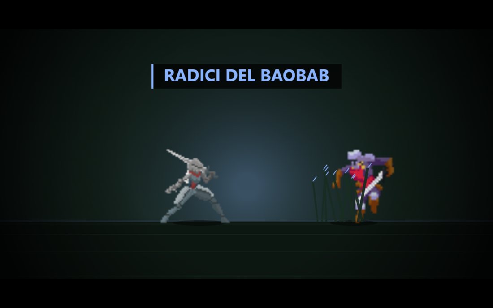
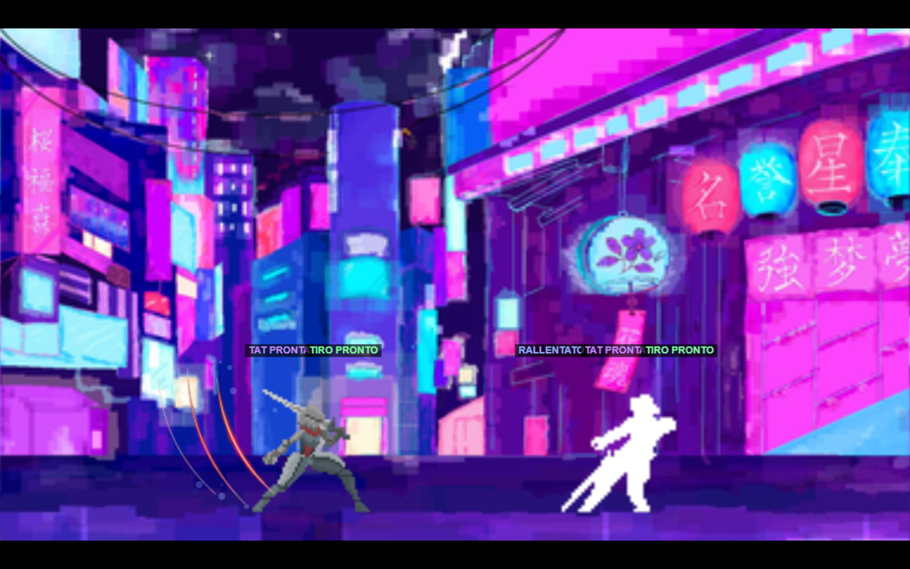
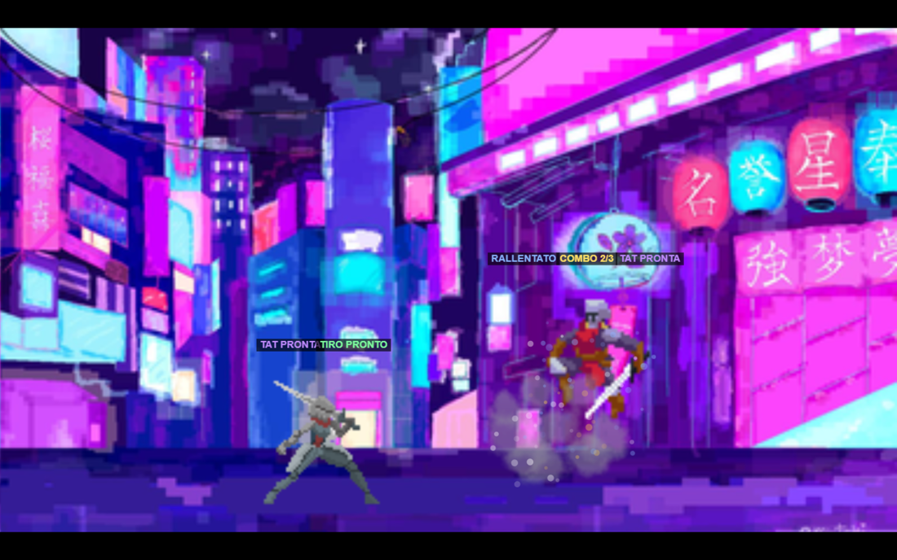
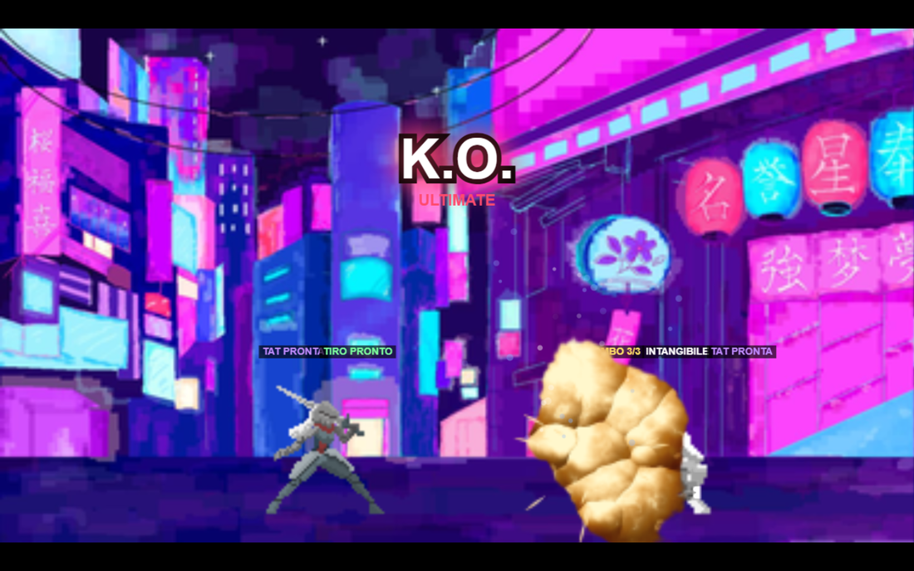
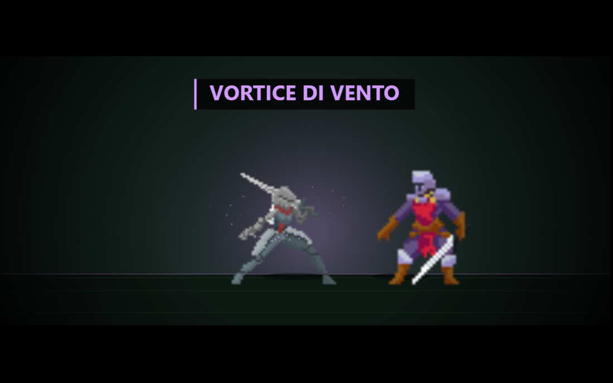
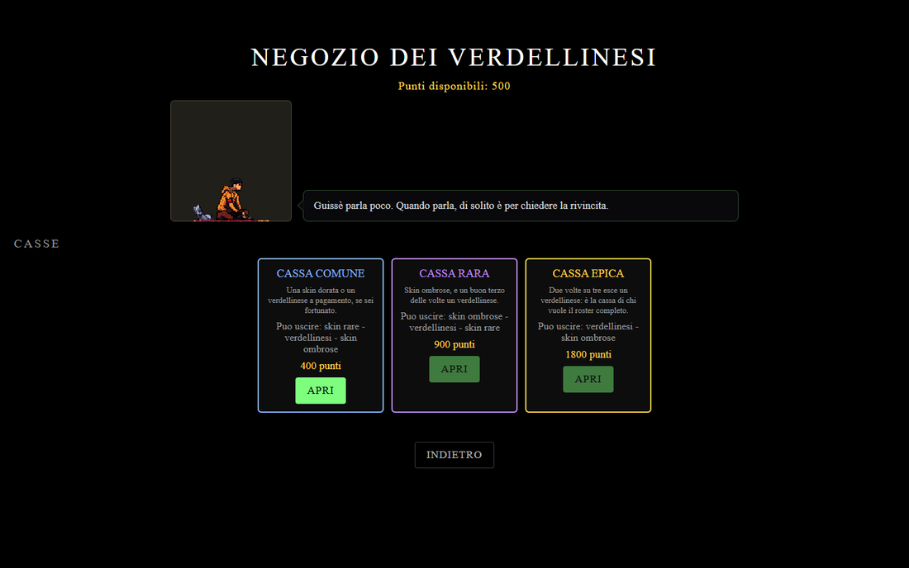
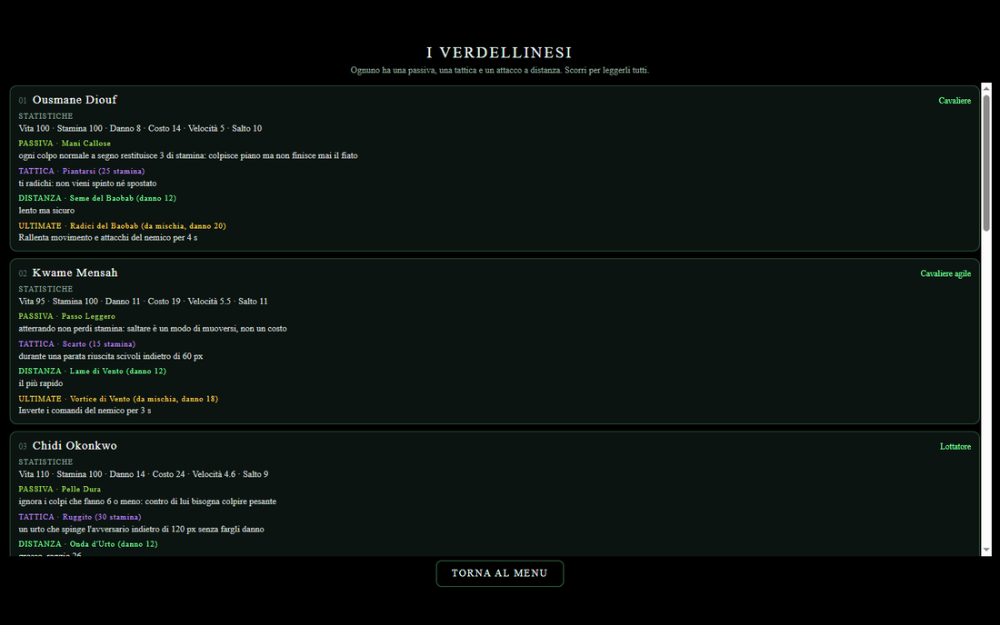
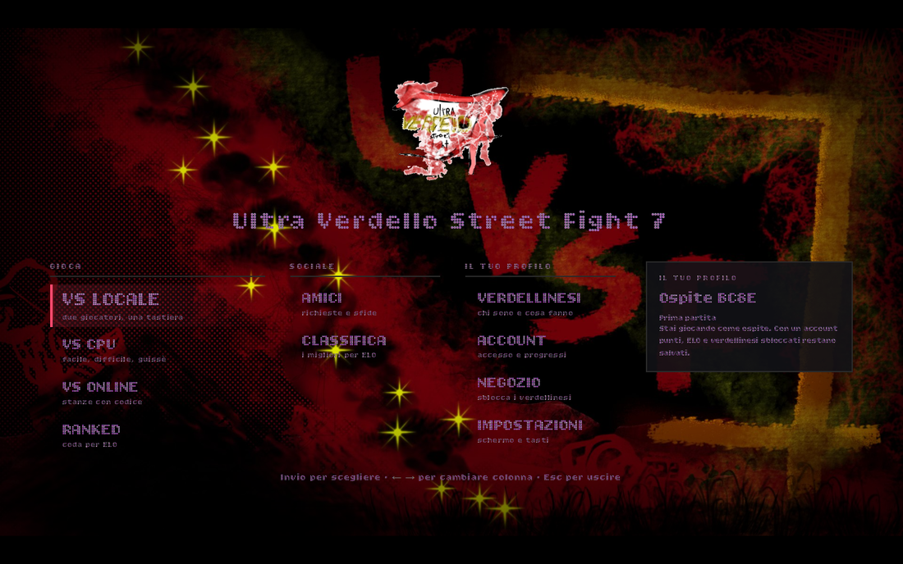
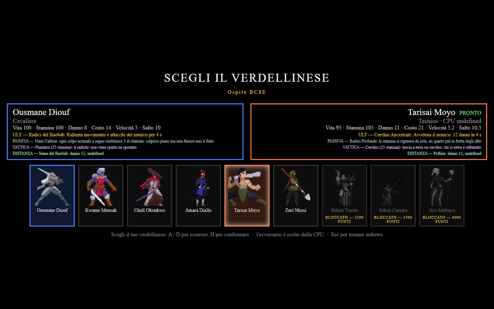

<p align="center">
  
</p>

<h1 align="center">Ultra Verdello Street Fight 7</h1>

<p align="center">
  Picchiaduro 2D in <strong>JavaScript vanilla</strong> su <strong>Canvas</strong>: due giocatori sulla stessa tastiera,
  contro una CPU con tre difficoltà, oppure online con stanze e codice.
</p>

<p align="center">
  
  
  
  
  
</p>

<p align="center">
  <a href="https://priestsn.github.io/uvstf7/"><strong>▶ GIOCA ORA: priestsn.github.io/uvstf7</strong></a><br>
  <a href="https://webcast-compared-for-briefing.trycloudflare.com/"><strong>🌐 VS ONLINE (stanze, account, ranked): webcast-compared-for-briefing.trycloudflare.com</strong></a>
</p>

<p align="center">
  <sub>La prima è la versione statica pubblicata da questo repository (GitHub Pages): si aggiorna a ogni push.
  La seconda è lo <strong>stesso gioco servito dal server delle stanze</strong>, dietro un tunnel Cloudflare:
  è lì che funzionano <strong>VS ONLINE</strong>, account, punti, ELO e classifica.
  È anche l'indirizzo del campo <strong>Website</strong> di questo repository (il link in alto a destra
  nella pagina GitHub). Attenzione: l'indirizzo del tunnel è <em>temporaneo</em> e cambia quando il tunnel
  viene riavviato — come leggerlo e come renderlo fisso è spiegato in
  <a href="#indirizzo-pubblico">Indirizzo pubblico</a>.</sub>
</p>

<p align="center">
  <a href="https://github.com/priestsn/uvstf7/releases/latest"><strong>📱 APP ANDROID</strong></a> —
  APK firmato, si aggiorna da solo: <code>uvsf7-v1.0.2.apk</code> (versione 1.0.2).<br>
  <sub>Chi non fa il login gioca come <strong>ospite</strong> con un id suo ("Ospite 3F2A"): punti ed ELO
  arrivano creando un account. La parte telefono vive in <code>css/mobile.css</code> e
  <code>js/Mobile.js</code>, il desktop non viene toccato — dettagli e misure in
  <a href="mobile.md">mobile.md</a>.</sub>
</p>

<p align="center">
  
</p>

<p align="center">
  <em>Quando una ultimate va a segno il gioco si ferma e parte una scena disegnata su misura per quel verdellinese.
  Qui <strong>Radici del Baobab</strong> di Ousmane Diouf, con il cartello, le barre nere e l'alone del colore del personaggio.</em>
</p>

---

## Indice

- [Galleria](#galleria)
- [Il gioco](#il-gioco)
- [Avvio rapido](#avvio-rapido)
- [Comandi](#comandi)
- [Meccaniche di combattimento](#meccaniche-di-combattimento)
- [La combo universale](#la-combo-universale)
- [I nove lottatori](#i-nove-lottatori)
- [Passive, tattiche e attacchi a distanza](#passive-tattiche-e-attacchi-a-distanza)
- [Le cutscene delle ultimate](#le-cutscene-delle-ultimate)
- [Punti, negozio e casse](#punti-negozio-e-casse)
- [Lo sciame e le prove](#lo-sciame-e-le-prove)
- [VS ONLINE](#vs-online)
- [Report bug](#report-bug)
- [Server e messa online](#server-e-messa-online)
- [Struttura del progetto](#struttura-del-progetto)
- [Scelte tecniche](#scelte-tecniche)
- [Stato di sviluppo](#stato-di-sviluppo)
- [Qualità e verifiche](#qualità-e-verifiche)
- [Requisiti](#requisiti)
- [Crediti e licenze](#crediti-e-licenze)

---

## Galleria

Tutte le immagini sono prese dalla versione attuale del gioco.

| Il combattimento | La combo in aria |
|---|---|
|  |  |

| Il bersaglio intangibile | La cutscene di Kwame Mensah |
|---|---|
|  |  |

| Il negozio con le tre casse | La tab dei verdellinesi |
|---|---|
|  |  |

| Menu principale | Selezione del personaggio |
|---|---|
|  |  |

| Fine partita con rivincita | Keybinds |
|---|---|
|  |  |

| Telefono in orizzontale | Telefono in verticale |
|---|---|
|  |  |

---

## Il gioco

Ultra Verdello Street Fight 7 (UVSF7) è un picchiaduro bidimensionale completo, scritto senza framework, senza bundler e senza una sola dipendenza npm: HTML, CSS e JavaScript più un piccolo server Node per la parte in rete.

**Cosa c'è dentro**

- **Tre modalità**: VS LOCALE (due giocatori, una tastiera), VS CPU (facile, difficile, guissè), VS ONLINE (stanze con codice su server).
- **Nove lottatori**, ognuno con statistiche, hitbox misurate sui pixel, **passiva, tattica, attacco a distanza e ultimate propria**.
- **Una combo universale** valida per tutti: si apre su un avversario stordito, prosegue in aria fino a tre colpi, il terzo spedisce lontano e chi la riceve diventa **intangibile per due secondi**.
- **Nove cutscene**, una per ultimate: quando la mossa va a segno il gioco si ferma e parte una scena disegnata su misura.
- **Combattimento tecnico**: parata con *perfect block*, attacco caricato che rompe la parata e stunna, stun, stati alterati, attacchi a distanza come chiusura della combo.
- **Economia e progressi**: punti senza tetto giornaliero, ranked con ELO, leghe, classifica, amicizie, e **casse di tre rarità** al posto delle vendite separate.
- **La tab VERDELLINESI** nel menu: la scheda completa di ognuno, passiva e tattica comprese.
- **HUD completo**: vita, stamina e barra ultimate per entrambi, timer da 60 secondi.
- **Flusso di gioco completo**: menu principale, sottomenu, pausa, fine partita con rivincita.
- **Report bug integrato**: il giocatore scrive e invia, il report arriva al server senza scaricare file.
- **Mobile**: comandi touch (leva e tasti), selezione a tocchi, layout responsive.
- **Keybinds**: tasti rimappabili per entrambi i giocatori, salvati nel browser.
- **Strumenti di debug**: tasto `U` per le hitbox e pannello con frame e stati dei lottatori.

Il progetto è accompagnato da due documenti di lavoro tenuti aggiornati: [`sviluppo.md`](sviluppo.md) (piano a fasi, decisioni, bilanciamento) e [`bugs.md`](bugs.md) (32 bug con causa, fix e verifiche).

---

## Avvio rapido

### Solo gioco locale (VS LOCALE e VS CPU)

Apri `index.html` nel browser. Funziona anche da `file://`: nessun server richiesto.

Se preferisci servirlo da HTTP:

```bash
python3 -m http.server 8000
# poi apri http://localhost:8000
```

### Con il server (VS ONLINE e report bug)

```bash
node server/server.js                 # porta 80
PORTA=8080 node server/server.js      # porta diversa
```

Apri `http://localhost:8080`. Controllo immediato: `http://localhost:8080/stato` restituisce JSON con stanze aperte, connessioni e uptime.

### Indirizzo pubblico

Il gioco è raggiungibile da un **tunnel Cloudflare** (`cloudflared`) aperto sulla VPS verso il server
Node, che ascolta solo su `127.0.0.1:8090`. Il tunnel non richiede account né DNS: Cloudflare assegna
un indirizzo `https://<nome>.trycloudflare.com` e inoltra il traffico, **WebSocket compresi**, quindi
funziona anche il VS ONLINE.

| Dove | Cosa contiene |
|---|---|
| `cloudflared-uvsf7.service` | il tunnel verso `http://127.0.0.1:8090` |
| `uvsf7.service` | il server Node del gioco (`PORTA=8090`, `HOST=127.0.0.1`) |
| `/etc/caddy/Caddyfile` | reverse proxy interno di riserva (nip.io), non è l'indirizzo pubblico |

**L'indirizzo del tunnel è temporaneo**: Cloudflare ne assegna uno nuovo a ogni riavvio del servizio
(riavvio della macchina, aggiornamento di `cloudflared`). Per leggere quello attivo:

```bash
uvsf7-indirizzo                      # sulla VPS
# oppure, da qualsiasi macchina con accesso SSH:
ssh root@<vps> 'journalctl -u cloudflared-uvsf7 --no-pager | grep -oE "https://[a-z0-9-]+\.trycloudflare\.com" | tail -1'
```

Se l'indirizzo cambia, va aggiornato qui nel README: il gioco invece non cambia, perché il client
parla con lo **stesso host da cui ha caricato la pagina** (`location.host` in `js/Rete.js`), quindi
nessun indirizzo è cablato nel codice.

**Per avere un indirizzo fisso** serve un tunnel *con nome* (`cloudflared tunnel create`), che
Cloudflare concede solo per un dominio gestito dal proprio account: in quel caso il nome diventa
qualcosa come `uvsf7.<tuo-dominio>` e non cambia più. Alternativa senza Cloudflare: Caddy con un
sottodominio DuckDNS, ma quel nome punta direttamente all'IP della VPS e lo espone.

**La versione giocabile senza server è su GitHub Pages**: `https://priestsn.github.io/uvstf7/`
(pubblica questo repository, si aggiorna a ogni push, e la usa anche l'app Android come
indirizzo di serie). Lì funzionano VS LOCALE e VS CPU; per il **VS ONLINE** serve invece
l'indirizzo del server delle stanze, che vive solo sul VPS.

Dietro Caddy c'è il reverse proxy: gestisce il certificato TLS e inoltra al server Node, che ascolta solo su `127.0.0.1:8090`.

> Con `file://` funzionano solo VS LOCALE e VS CPU: senza server non esiste l'indirizzo WebSocket delle stanze né l'invio dei report.

---

## Comandi

### Tastiera (valori predefiniti)

| Azione | Giocatore 1 | Giocatore 2 |
|---|---|---|
| Sinistra / Destra | `A` / `D` | `←` / `→` |
| Salto | `W` | `↑` |
| Attacco (tieni premuto per caricare) | `H` | `Ù` |
| Parata (tieni premuto) | `J` | `À` |
| Ultimate (a barra piena) | `G` | `L` |
| Attacco a distanza | `K` | `Ò` |
| Tattica | `Y` | `Ì` |

| Altro | Tasto |
|---|---|
| Pausa | `Esc` |
| Hitbox e pannello di debug | `U` |
| Report bug | `Esc` → `REPORT BUG` |

### Keybinds

`SETTINGS → KEYBINDS` (anche in partita: `Esc → IMPOSTAZIONI → KEYBINDS`). Si scorre con le frecce o `W`/`S`, si preme `Invio` e poi il tasto da assegnare. La configurazione è salvata nel browser (`localStorage`, chiave `uvsf7-keybinds`) e vale anche per i comandi touch. `RIPRISTINA PREDEFINITI` rimette tutto a posto. `Esc`, `Invio`, `Tab` e `U` sono riservati a menu, pausa e debug.

### Touch (telefono e tablet)

In partita compaiono da soli e solo su dispositivi touch:

- **leva virtuale** a sinistra: trascina a sinistra o destra per muoverti, verso l'alto per saltare;
- **ATT**: tienilo premuto per l'attacco caricato, rilascia per colpire;
- **PAR**: parata finché il dito resta sul tasto;
- **DIS**: attacco a distanza, il modo per continuare dopo la combo;
- **TAT**: tattica, diversa per ogni verdellinese;
- **ULT**: ultimate.

In VS LOCALE ci sono due gruppi con sigla `P1` / `P2`, uno per lato. In VS ONLINE il telefono comanda il giocatore che lo sta usando. Nella schermata di selezione i pulsanti `<` `>` `CONFERMA` e le celle toccabili permettono di giocare senza tastiera.

### Menu

| Schermata | Voci |
|---|---|
| Principale | `PLAY`, `SETTINGS` |
| Play | `VS LOCALE`, `VS CPU`, `VS ONLINE`, `INDIETRO` |
| VS CPU | `FACILE`, `DIFFICILE`, `GUISSÈ`, `INDIETRO` |
| VS ONLINE | `CREA STANZA`, `ENTRA CON CODICE`, `INDIETRO` |
| Impostazioni | `FULLSCREEN`, `KEYBINDS`, `INDIETRO` |
| Pausa (`Esc`) | `RIPRENDI`, `IMPOSTAZIONI`, `ESCI AL MENU` |
| Fine partita | `RIVINCITA`, `CAMBIA PERSONAGGI`, `ESCI AL MENU` |

`Esc` fa sempre da tasto indietro: in ogni menu c'è anche la voce esplicita e una riga di aiuto che ricorda cosa fa.

---

## Meccaniche di combattimento

- **Vita e stamina**: attaccare e parare consumano stamina; la stamina si rigenera ogni due secondi (la bruciatura la blocca).
- **Parata**: blocca i danni finché hai stamina. Si può avviare solo da terra; saltare annulla la parata.
- **Perfect block**: parando entro **3 frame** dall'inizio dell'attacco avversario non subisci danno, guadagni **+15** di carica ultimate e l'attaccante resta **stunnato 1 secondo** mostrando l'animazione di danno.
- **Colpo caricato e stun**: il caricato, quando va a segno, **stunna anche senza parata**. Prima lo faceva solo rompendo una parata, e la combo era quasi irraggiungibile: tre porte d'ingresso sono meglio di una.
- **Attacco caricato**: tieni premuto l'attacco per **1 secondo** (barra sopra il lottatore e scritta `CARICATO`). Al rilascio il colpo **rompe la parata**, infligge danno e stunna per 1 secondo. Costo: **1,5x** stamina. Durante la carica non puoi muoverti, saltare, parare o usare l'ultimate.
- **Ultimate**: barra dedicata sotto la stamina, piena in circa **20 secondi**, più veloce con le parate perfette, che si perde quando vieni stunnato (−25). Ogni ultimate ha tipo (mischia, proiettile, buff) ed effetto proprio.
- **Stun**: blocca movimento, salto, attacco, parata e ultimate; gli input premuti durante lo stun vengono ignorati.
- **Timer**: 60 secondi. Vince chi azzera la vita dell'avversario; allo scadere vince chi ha più vita.

### Stati alterati

| Stato | Effetto |
|---|---|
| `RALLENTATO` | velocità −50%, animazioni +80% |
| `INVERSO` | comandi invertiti |
| `ECLISSI` | inversione + rallentamento |
| `CONGELATO` | nessuna azione possibile |
| `VELENO` | 12 danni nel tempo |
| `BRUCIATO` | 14 danni nel tempo e stamina che non rigenera |
| `MARCHIATO` | +30% danni subiti |
| `SILENZIO` | niente ultimate, stamina in calo |
| `VELOCE` | buff: velocità +50%, animazioni −40% |

---

## La combo universale

Una sola combo, uguale per tutti i verdellinesi. Sei regole, nell'ordine in cui sono state pensate:

1. un colpo normale **spinge l'avversario fuori dal raggio**: lo scambio finisce lì;
2. un colpo su un avversario **stordito** lo porta **leggermente in alto e in avanti**: da lì comincia la combo;
3. in aria si fanno **fino a tre attacchi consecutivi**;
4. il **terzo** lo spedisce **lontano** da chi lo ha colpito;
5. dopo, l'unico modo per continuare è un **attacco a distanza**;
6. chi riceve la combo diventa **intangibile per un paio di secondi**, lampeggiando bianco.

I numeri, tutti in `js/Combo.js` — un modulo puro, che si prova con `node tools/prova_combo.js` senza aprire il browser:

| Parametro | Valore |
|---|---|
| Sollevamento al primo colpo | +60 px in alto, +40 px in avanti |
| Sospensione fra un colpo e l'altro | 18 fotogrammi, gravità al 30% |
| Danno dei tre colpi | ×1,00 · ×0,85 · ×0,70 |
| Spinta del terzo colpo | 320 px/s |
| Intangibilità | 120 fotogrammi (2 s), lampeggio bianco ogni 6 |
| Tetto di danno per combo | 45% della vita massima |

<p align="center">
  
  <br><em>Secondo colpo: il bersaglio è sospeso, l'HUD dice <code>COMBO 2/3</code>, e a sinistra si leggono <code>TAT PRONTA</code> e <code>TIRO PRONTO</code>.</em>
</p>

**Due decisioni che vanno spiegate.** L'intangibilità **parte all'atterraggio**, non dal primo colpo: prese alla lettera, la regola 5 e la regola 6 si contraddicono, perché un bersaglio intangibile non potrebbe essere colpito dal tiro che dovrebbe continuare la combo. All'atterraggio invece la combo è finita davvero, e il tiro è già partito. E se il bersaglio **atterra prima di chiudere i tre colpi**, la combo si perde e non c'è intangibilità: si diventa intangibili solo subendo la combo intera.

---

## I nove lottatori

Valori come mostrati nella schermata di selezione: `Danno` e `Costo` sono quelli dell'attacco base, il salto è il valore assoluto della spinta.

| Personaggio | Archetipo | Vita | Stamina | Danno | Costo | Velocità | Salto |
|---|---|---:|---:|---:|---:|---:|---:|
| Ousmane Diouf | Cavaliere | 100 | 100 | 8 | 14 | 5 | 10 |
| Kwame Mensah | Cavaliere agile | 95 | 100 | 11 | 19 | 5,5 | 11 |
| Chidi Okonkwo | Lottatore | 110 | 100 | 14 | 24 | 4,6 | 9 |
| Amara Diallo | Lottatore veloce | 90 | 100 | 9 | 17 | 6 | 11,5 |
| Tarisai Moyo | Tecnico | 95 | 105 | 11 | 21 | 5,2 | 10,5 |
| Zuri Nkosi | Cacciatrice | 88 | 100 | 10 | 18 | 5,8 | 11,5 |
| Bakari Traore | Mago | 85 | 110 | 13 | 20 | 4,4 | 9 |
| Sekou Camara | Mago anziano | 95 | 105 | 12 | 19 | 4,6 | 9,5 |
| Ayo Adebayo | Arcimago | 88 | 100 | 14 | 22 | 5 | 10 |

Regola di bilanciamento: attacco veloce e corto = meno danno e meno stamina; attacco lento e con hitbox grande = più danno e più costo. I maghi compensano il danno alto con meno vita. Le tabelle complete (avvio, durata, hitbox misurate in pixel) sono in [`sviluppo.md`](sviluppo.md).

### Ultimate

| Personaggio | Ultimate | Tipo | Danno | Effetto |
|---|---|---|---:|---|
| Ousmane Diouf | Radici del Baobab | Mischia | 20 | Rallentamento per 4 s |
| Kwame Mensah | Vortice di Vento | Mischia | 18 | Inversione comandi per 3 s |
| Chidi Okonkwo | Ruggito del Leone | Mischia | 24 | Congelamento per 1,5 s |
| Amara Diallo | Danza Fulminea | Buff | 0 | Velocità +50% per 5 s |
| Tarisai Moyo | Cerchio Ancestrale | Mischia | 20 | Veleno: 12 danni in 4 s |
| Zuri Nkosi | Freccia della Savana | Mischia | 18 | Marchio +30% per 5 s |
| Bakari Traore | Pioggia di Stelle | Proiettile | 24 | Bruciatura: 14 danni in 4 s |
| Sekou Camara | Giudizio degli Antenati | Proiettile | 22 | Silenzio per 4 s |
| Ayo Adebayo | Eclissi Arcana | Proiettile | 26 | Eclissi per 3 s |

I proiettili sono sfere animate disegnate sul canvas: viaggiano in avanti, rompono la parata e applicano danno e stato. Le ultimate da mischia colpiscono una sola volta per attivazione.

**Quando una ultimate va a segno parte una cutscene**: vedi [Le cutscene delle ultimate](#le-cutscene-delle-ultimate).

---

## Passive, tattiche e attacchi a distanza

Ogni verdellinese dice **una cosa sola**: un'identità meccanica. Le tattiche usano **un solo tasto nuovo per tutti** (`Y` / `Ì`): stesso gesto, nove effetti.

| Verdellinese | Passiva | Tattica (costo) |
|---|---|---|
| **Ousmane Diouf** | *Mani Callose*: ogni colpo normale a segno restituisce 3 di stamina. Colpisce piano ma non finisce mai il fiato. | *Piantarsi* (25): ti radichi 40 passi, non vieni spinto né spostato. |
| **Kwame Mensah** | *Passo Leggero*: atterrando non perdi stamina. Saltare è un modo di muoversi, non un costo. | *Scarto* (15): durante una parata riuscita scivoli indietro di 60 px. |
| **Chidi Okonkwo** | *Pelle Dura*: ignora i colpi che fanno 6 o meno. Contro di lui bisogna colpire pesante. | *Ruggito* (30): un urto che spinge 120 px senza fare danno. |
| **Amara Diallo** | *Contraccolpo*: ogni colpo che subisce le dà 2 di ultimate. Il dolore è la sua carica. | *In Tempo* (20): colpire entro poco da una parata riuscita fa il 25% in più. |
| **Tarisai Moyo** | *Radici Profonde*: la stamina si rigenera nel tempo. È l'unica che si stanca davvero poco. | *Cerchio* (25): lascia a terra una zona che rallenta chi ci entra. |
| **Zuri Nkosi** | *Istinto*: colpire entro 10 passi da un attacco mancato dall'avversario fa il 50% in più. | *Freccia Corta* (18): una freccia che non fa danno e prepara il marchio. |
| **Bakari Traore** | *Polvere da Sparo*: i proiettili costano il 30% in meno. | *Puntamento* (20): restando fermo, il proiettile successivo è più veloce e più grosso. |
| **Sekou Camara** | *Voce degli Antenati*: non subisce silenzio né inversione. Nessuno gli spegne le abilità. | *Sentenza* (22): applica silenzio, ma solo se l'avversario è stordito. |
| **Ayo Adebayo** | *Ultimo Raggio*: sotto il 40% di vita i suoi colpi fanno il 15% in più. Non è mai finito. | *Eclissi Minore* (30): spegne la vista all'avversario per un secondo. |

**Attacchi a distanza**: danno 12 per tutti (sono la chiusura della combo, non la fonte di danno), 20 stamina, ricarica 90 fotogrammi.

| Verdellinese | Nome | Velocità | Nota |
|---|---|---:|---|
| Ousmane Diouf | Seme del Baobab | 7 | lento ma sicuro |
| Kwame Mensah | Lame di Vento | 13 | il più rapido |
| Chidi Okonkwo | Onda d'Urto | 6 | grosso, raggio 26 |
| Amara Diallo | Passo Doppio | 10 | piccolo, difficile da vedere |
| Tarisai Moyo | Polline | 9 | applica veleno |
| **Zuri Nkosi** | **Freccia del Ritorno** | 11 | **speciale: nessun danno, stunna chi la para, teletrasporta dietro chi la prende** |
| Bakari Traore | Stella Cadente | 10 | danno 14 |
| Sekou Camara | Sguardo degli Antenati | 8 | applica silenzio |
| Ayo Adebayo | Raggio d'Eclissi | 12 | danno 14 |

---

## Le cutscene delle ultimate

Le ultimate restano quelle della tabella qui sopra — alcune da mischia, altre a distanza — ma quando **vanno a segno** il gioco si ferma per circa un secondo e mezzo e parte una scena disegnata per quel personaggio: **sipario** (barre nere, mondo desaturato), **gesto** (quello che solo lui sa fare), **colpo** (fermo immagine, flash, il nome della mossa) e **ritorno**.

| Verdellinese | Scena | Il gesto unico |
|---|---|---|
| Ousmane Diouf | RADICI DEL BAOBAB | la telecamera striscia **a terra**: il baobab è sotto, non sopra |
| Kwame Mensah | VORTICE DI VENTO | **il mondo si inclina** di 15° e non torna finché non scatta dritto |
| Chidi Okonkwo | RUGGITO DEL LEONE | **un secondo di immobilità assoluta** prima del ruggito |
| Amara Diallo | DANZA FULMINEA | tre ombre che danzano e rientrano in lei |
| Tarisai Moyo | CERCHIO ANCESTRALE | **inquadratura dall'alto**: il campo diventa una mappa |
| Zuri Nkosi | FRECCIA DELLA SAVANA | il punto di vista **è la freccia** che attraversa lo schermo |
| Bakari Traore | PIOGGIA DI STELLE | **il cielo**, che il gioco non aveva mai mostrato |
| Sekou Camara | GIUDIZIO DEGLI ANTENATI | le icone dei comandi del nemico **si spengono** una per una |
| Ayo Adebayo | ECLISSI ARCANA | **sei passi di nero assoluto** |

<p align="center">
  
  <br><em>Kwame: l'inclinazione piega il fondale <strong>e</strong> gli attori, non solo gli sprite — la rotazione del canvas vale solo per ciò che si disegna dopo.</em>
</p>

**Il danno arriva alla fine della scena**, non prima: il colpo si vede tutto, e la scena non è un intermezzo decorativo sopra un calcolo già fatto. I copioni stanno in `js/Cutscene.js` come **dati** (fasi contate in passi, durate 86-94 passi), il disegno proprio di ognuno in `js/EffettiCutscene.js`: aggiungere una scena domani significa aggiungere un elemento all'elenco.

---

## Punti, negozio e casse

I punti si guadagnano giocando, **senza alcun tetto giornaliero**:

| Esito | Punti |
|---|---:|
| Vittoria | 300 |
| Pareggio | 200 |
| Sconfitta | 120 |

Nel negozio **non si comprano più skin e verdellinesi separatamente**: si comprano **tre casse**. Il sorteggio sta **sul server** (`apriCassa` in `server/account.js`): una modifica al client non regala niente. Il server sceglie prima la categoria con i pesi, poi il premio dentro la categoria, e **non fa mai uscire un doppione**: i premi che possiedi escono dal sorteggio, e se non resta niente la cassa non si apre e i punti non si toccano.

| Cassa | Prezzo | Cosa può uscire | Verdellinese (misurato su 200 estrazioni) |
|---|---:|---|---:|
| Comune | 400 | skin rare, verdellinesi, skin ombrose | 27% |
| Rara | 900 | skin ombrose, verdellinesi, skin rare | ~35% |
| Epica | 1.800 | verdellinesi, skin ombrose | 56% |

<p align="center">
  
  <br><em>Le tre casse si distinguono dal colore del bordo; sotto ognuna c'è scritto cosa può uscire, così non è una scatola cieca.</em>
</p>

Le skin che possiedi restano nel negozio per **indossarle**, senza prezzo.

---

## Lo sciame e le prove

Oltre alle prove automatiche, il gioco è sorvegliato da uno **sciame di bot veri**: persone finte che si iscrivono, stringono amicizie, comprano, giocano ranked fra loro e alla fine dicono che cosa pretendono dal gioco. Ogni bot è un processo Chrome pilotato via CDP, e ogni corsa produce un file di eventi leggibile: `bug_reports/swarm-*/eventi.jsonl`.

Capacità misurata con `tools/swarm/capacita.js` — quanti bot regge una macchina senza scendere sotto i 60 passi al secondo, che è il ritmo del gioco:

| Macchina | Bot | Passi al secondo |
|---|---:|---|
| PC di sviluppo (Ryzen 5 5600G, 16 GB) | 12 | 60 tutti |
| BC-250 (12 core, memoria unificata) | 12 | 64-69 |

In una corsa notturna tipica: **630 partite**, 105 giri di verifica, **0 percorsi d'errore falliti, 0 invarianti violate**, persistenza dei dati confermata al ricaricamento.

Le prove sono **36 file** e si lanciano una per una, ognuna stampa `OK`/`FALLITO` riga per riga e chiude col conteggio (un test che non dice quanti controlli ha fatto non è verificabile):

```bash
node tools/prova_motore.js       # motore: collisioni, stati, fine partita
node tools/prova_combo.js        # combo: moltiplicatori, tetto di danno, intangibilità
node tools/prova_cutscene.js     # i nove copioni: durate, fasi, ripetibilità
node tools/prova_casse.js        # casse: doppioni, punti, probabilità
node tools/prova_invarianti.js   # invarianti del gioco
```

---

## VS ONLINE

Due giocatori su macchine diverse, stanza con codice di 4 caratteri.

### Flusso

1. `PLAY → VS ONLINE → CREA STANZA`: il server genera un codice, mostrato nel badge in alto.
2. L'altro apre lo stesso indirizzo, sceglie `ENTRA CON CODICE` e digita il codice.
3. Ognuno sceglie il proprio personaggio (la schermata mostra la propria scheda `TU` e l'altra come `AVVERSARIO`).
4. Quando entrambi confermano parte la partita.

### Come funziona la rete

| Ruolo | Chi | Cosa fa |
|---|---|---|
| **host** | chi crea la stanza | simula la partita nel proprio browser e manda **30 fotogrammi al secondo** all'ospite |
| **ospite** | chi entra col codice | non simula nulla: disegna lo stato ricevuto e manda le proprie **azioni** |
| **server** | `server/server.js` | serve i file e inoltra i messaggi dentro la stanza: non calcola il combattimento |

- Viaggia l'**azione** (sinistra, salto, attacco, parata, ultimate), non il tasto: ogni giocatore tiene i propri keybinds.
- Il campo di gioco è fissato all'inizio della partita (stesse misure del canvas dell'host) e il browser dell'ospite lo scala via CSS: le posizioni cadono negli stessi pixel.
- La CPU non ha una seconda logica di combattimento: scrive sugli stessi input del giocatore.

### Dopo la partita

- `RIVINCITA`: stessa coppia di personaggi, timer azzerato. In rete riparte per entrambi.
- `CAMBIA PERSONAGGI`: torna alla selezione; in rete la schermata si apre su tutti e due.

### Limiti noti

- La pausa (`Esc`) in VS ONLINE ferma solo il browser in cui viene premuta.
- Se chiude l'host, la partita finisce per entrambi; se chiude l'ospite, l'host torna al menu.
- Non c'è riconnessione automatica: si ricrea la stanza.

---

## Report bug

`Esc` in partita → `REPORT BUG`. Si scrive il problema e si preme **INVIA**:

- il contesto viene allegato da solo (stato, modalità, difficoltà, timer, personaggi, posizioni, vita, stamina, ultimate, frame);
- il gioco fa `POST /report` e il server accoda il report in `/var/lib/uvsf7/reports/report-AAAA-MM-GG.md`, con data, IP e user agent;
- **non serve scaricare nessun file**;
- se il server non risponde, il report resta in `localStorage` e viene reinviato alla riapertura del pannello. `ESPORTA MD` e `COPIA` restano come riserva.

Lettura dei report (serve la chiave impostata in `REPORT_CHIAVE`):

```bash
curl "http://<server>/reports?chiave=<CHIAVE>"
curl "http://<server>/reports/file?chiave=<CHIAVE>&nome=report-2026-10-17.md"
```

---

## Server e messa online

Il server è **un solo file Node, senza dipendenze**: HTTP statico più WebSocket e stanze, scritti a mano (handshake, frame di testo, ping/pong, close). Con 1 GB di RAM regge molte stanze, perché il combattimento non gira lì.

```bash
node server/server.js
```

| Variabile | Default | Significato |
|---|---|---|
| `PORTA` | `80` | porta HTTP/WebSocket (in produzione `8090`, dietro Caddy) |
| `REPORT_DIR` | `/var/lib/uvsf7/reports` | cartella dei report |
| `REPORT_CHIAVE` | *(vuota)* | chiave per leggere i report; se vuota la lettura risponde 403 |
| `HOST` | `0.0.0.0` | indirizzo di ascolto; con il proxy davanti si usa `127.0.0.1` |

| Endpoint | Descrizione |
|---|---|
| `GET /` | il gioco |
| `GET /stato` | JSON con stanze, connessioni e uptime |
| `POST /report` | invio di un report bug |
| `GET /reports?chiave=…` | elenco dei file di report |
| `GET /reports/file?chiave=…&nome=…` | contenuto di un file di report |
| `WS /ws` | canale delle stanze (funziona anche dietro proxy: Caddy inoltra l'upgrade) |

### Installazione su VPS (Ubuntu 24.04)

```ini
# /etc/systemd/system/uvsf7.service
[Unit]
Description=Ultra Verdello Street Fight 7
After=network.target

[Service]
Type=simple
WorkingDirectory=/opt/uvsf7
ExecStart=/usr/bin/node /opt/uvsf7/server/server.js
Restart=always
RestartSec=3
Environment=PORTA=80
Environment=REPORT_DIR=/var/lib/uvsf7/reports
Environment=REPORT_CHIAVE=cambia-questa-chiave

[Install]
WantedBy=multi-user.target
```

```bash
systemctl daemon-reload && systemctl enable --now uvsf7
ufw allow 80/tcp
curl http://<ip-pubblico>/stato
```

Sul server servono solo `index.html`, `index.js`, `css/`, `js/`, `server/` e gli asset davvero usati (`assets/Background.png`, `assets/UVSF7-logo.png`, `assets/Personaggi/`): circa 1,5 MB.

### Tunnel Cloudflare (l'indirizzo pubblico attuale)

È il modo usato oggi: nessun account, nessun DNS, e **l'IP della VPS non compare** nell'indirizzo.
`cloudflared` apre un tunnel verso il server Node (che resta su `127.0.0.1:8090`) e Cloudflare
pubblica l'indirizzo `https://<nome>.trycloudflare.com`.

```bash
# 1. cloudflared (Ubuntu/Debian, pacchetto ufficiale)
curl -fsSL https://pkg.cloudflare.com/cloudflare-main.gpg -o /usr/share/keyrings/cloudflare-main.gpg
echo "deb [signed-by=/usr/share/keyrings/cloudflare-main.gpg] https://pkg.cloudflare.com/cloudflared any main" \
  > /etc/apt/sources.list.d/cloudflared.list
apt update && apt install -y cloudflared

# 2. servizio del tunnel verso il gioco
cat > /etc/systemd/system/cloudflared-uvsf7.service <<'EOF'
[Unit]
Description=Tunnel Cloudflare per UVSF7 (indirizzo pubblico del gioco)
After=network-online.target uvsf7.service
Wants=network-online.target uvsf7.service

[Service]
Type=simple
ExecStart=/usr/local/bin/cloudflared tunnel --no-autoupdate --url http://127.0.0.1:8090
Restart=always
RestartSec=5

[Install]
WantedBy=multi-user.target
EOF

systemctl daemon-reload && systemctl enable --now cloudflared-uvsf7

# 3. leggere l'indirizzo assegnato (cambia a ogni riavvio)
journalctl -u cloudflared-uvsf7 --no-pager | grep -oE 'https://[a-z0-9-]+\.trycloudflare\.com' | tail -1
```

Il percorso di `cloudflared` nel servizio è `/usr/local/bin/cloudflared` (binario scaricato a mano);
con il pacchetto Debian il comando sta in `/usr/bin/cloudflared` — controllare con `which cloudflared`.

Controllo veloce che il tunnel inoltri tutto, WebSocket compresi:

```bash
node -e "const w=new WebSocket('wss://<nome>.trycloudflare.com/ws');w.onopen=()=>w.send(JSON.stringify({t:'crea'}));w.onmessage=e=>{console.log(e.data);process.exit(0)}"
# atteso: {"t":"creata","codice":"XXXX"}
```

### HTTPS con un nome fisso (Caddy + dominio)

Installazione in [`server/LEGGIMI.md`](server/LEGGIMI.md). In breve: Caddy su 80/443 con certificato Let's Encrypt automatico, Node spostato su `127.0.0.1:8090` e reverse proxy verso di lui (WebSocket compreso).

```caddyfile
# <tuo-dominio>  =  il nome pubblico che scegli (dominio, DuckDNS o nip.io)
<tuo-dominio> {
    encode zstd gzip
    reverse_proxy 127.0.0.1:8090
}
```

Se un giorno compri un dominio (o usi DuckDNS), cambia solo la prima riga del `Caddyfile` e il link nel README: il certificato si rinnova da solo.

---

## Struttura del progetto

```
index.html            markup: canvas, HUD, menu, schermate, pannelli
index.js              game loop, fisica, collisioni, combattimento, avvio partita
css/style.css         tutti gli stili, responsive compreso
js/Utili.js           costanti condivise, caricamento asset, timer, vincitore
js/Stato.js           macchina a stati del gioco
js/Keybinds.js        tasti rimappabili: dati, salvataggio, schermata
js/Report.js          pannello report bug e invio al server
js/Menu.js            menu come dati, voci WIP, suggerimenti, fullscreen
js/Classi.js          classi Sprite e Lottatore: animazioni, hitbox, attacco
js/Verdellinesi.js    dati dei 9 lottatori: statistiche, sprite, passiva, tattica, distanza, ultimate
js/Combo.js           la combo universale come modulo puro (fasi, moltiplicatori, tetto)
js/Cutscene.js        i nove copioni delle scene, come dati
js/EffettiCutscene.js il disegno proprio di ogni scena
js/Roster.js          la tab VERDELLINESI del menu
js/Negozio.js         il negozio con le tre casse
js/Account.js         sessione, profilo, possessi, skin indossate
js/Classifica.js      classifica per ELO
js/Amici.js           amicizie e sfide
js/Coda.js            coda ranked
js/Selezione.js       scelta del personaggio, diversa per modalità
js/CPU.js             avversario controllato dal computer, tre difficoltà
js/Rete.js            collegamento WebSocket con il server
js/Online.js          VS ONLINE: stanze, fotogrammi di stato, azioni
js/Touch.js           leva e tasti virtuali
server/server.js      HTTP + WebSocket + stanze + report
server/LEGGIMI.md     installazione e messa online
assets/Personaggi/    sprite per personaggio: idle, run, jump, fall, attack, takehit, death, parry
assets/               sfondo animato, logo, sprite storici Player/Enemy
sviluppo.md           piano a fasi, decisioni, tabelle di bilanciamento
bugs.md               32 bug con causa, fix e verifiche
```

| Area | Righe | File |
|---|---:|---:|
| `index.js` (motore) | 2.982 | 1 |
| `js/` (moduli del client) | 8.583 | 35 |
| `server/` | 2.834 | 5 |
| `tools/prova_*.js` (prove) | 4.158 | 36 |
| `tools/swarm/` (sciame) | 5.985 | 32 |

Circa **14.500 righe** di JavaScript scritte a mano, senza framework, senza bundler e senza una sola dipendenza npm.

### Ordine di caricamento degli script

```
Utili → Stato → Keybinds → Report → Menu → Classi → Personaggi
      → Selezione → CPU → Rete → Online → Touch → index
```

L'ordine conta: gli script condividono lo scope globale e usano solo dichiarazioni di funzione, così nessuno dipende da un file caricato dopo (era il bug BUG-12, ora chiuso).

---

## Scelte tecniche

- **Niente framework, niente build step, niente npm.** Si apre il file e funziona; il server usa solo moduli standard di Node.
- **Logica per frame, non `deltaTime`.** Frame d'impatto, perfect block, stun e carica sono contati in frame: il combattimento è deterministico e leggibile.
- **Una sola fonte di verità per l'attacco**: la fine dell'animazione è decisa dal `Lottatore`, non da `setTimeout`.
- **Host autoritativo in rete**: un solo simulatore, niente rollback né predizione. L'ospite vede lo stato con la latenza della rete.
- **Input a strati**: tasto fisico → `azioneDaTasto()` → `premiAzione()`. Tastiera, keybinds, comandi touch e ospite online passano tutti da qui.
- **Misure dai pixel**: `scale`, `offset`, hitbox e frame d'impatto di ogni personaggio sono stati misurati sui fogli reali; su schermi stretti tutto viene riscalato con un unico fattore, così le collisioni restano coerenti.
- **Dati, non codice**: menu, personaggi, casse e keybinds sono tabelle; aggiungere una voce, una cassa o un lottatore non richiede toccare il game loop.
- **Le scene sono copioni, non codice**: `js/Cutscene.js` elenca fasi contate in passi, il motore le esegue. È lo stesso schema della cerimonia di fine partita, e garantisce che due client mostrino la stessa scena fotogramma per fotogramma.
- **I moduli puri si provano senza browser**: `Combo.js`, `Regole.js`, `Comandi.js` non toccano il DOM, quindi le loro prove girano in un decimo di secondo con Node.
- **Il server è l'unica autorità sull'economia**: punti, acquisti e contenuto delle casse si decidono lì.

---

## Stato di sviluppo

| Fase | Contenuto | Stato |
|---|---|---|
| 1 | CSS esterno, stati di gioco, menu, fullscreen | completata |
| 2 | Selezione personaggio, 9 lottatori con sprite dedicati | completata |
| 3 | Perfect block, ultimate, attacco caricato, stun | completata |
| 4 | VS CPU con tre difficoltà | completata |
| 5 | VS ONLINE: server, stanze, fotogrammi di stato | completata |
| 6 | Keybinds, touch, rivincita, selezione per modalità, report sul server | completata |
| 7 | Account, punti, ELO, leghe, classifica, amicizie, sfide | completata |
| 8 | Combo universale, attacchi a distanza, passive e tattiche dei nove | completata |
| 9 | Nove cutscene delle ultimate, tab VERDELLINESI, casse nel negozio | completata |
| 10 | Sciame di bot e prove automatiche | completata |

**Ancora aperto**

- animazioni di parata: `parry.png` di alcuni personaggi è ancora un segnaposto;
- salto e caduta di Bakari Traore sono provvisori (assenti nel pacchetto originale);
- effetti sonori e musica: non ancora iniziati — le cutscene si reggono su camera, colore e testo;
- **i bot non sfruttano ancora tutte le meccaniche**: nelle partite fra loro raramente arrivano a caricare la ultimate o a chiudere una combo. La misura esiste e lo dice; il lavoro che manca è sulla qualità del combattimento dei bot, non sul gioco;
- l'uscita dal menu dopo una rivincita non è sempre libera quando l'altro giocatore è già uscito.

---

## Qualità e verifiche

Il progetto tiene un registro dei bug reale, non decorativo:

- **32 bug** documentati in [`bugs.md`](bugs.md) con causa, impatto, fix e verifica: tutti chiusi. Dove la correzione è parziale il motivo è dichiarato (per esempio la dipendenza dal frame rate è una scelta di progetto: logica per frame, senza `deltaTime`).
- **12 giri di fix** con data, elenco delle modifiche e tabella delle verifiche eseguite.
- Verifiche fatte nel browser reale, non solo a occhio: frame fatti avanzare a mano per controllare stun, carica, perfect block e fine partita; due schede collegate al server per la rete; viewport telefono per il layout mobile.

Controlli tipici dopo una modifica:

1. `node --check` su tutti i file JS toccati.
2. Partita VS LOCALE: attacco normale, attacco caricato, parata, perfect block, ultimate.
3. VS CPU su tutte e tre le difficoltà.
4. VS ONLINE: creazione stanza, ingresso col codice, rivincita, uscita dell'avversario.
5. Mobile: menu, selezione a tocchi, comandi touch.
6. Report bug: invio e presenza del file sul server.

---

## Requisiti

- Browser moderno con Canvas 2D (Chrome, Edge, Firefox, Safari); nessun plugin.
- Per VS ONLINE e report: Node 18 o superiore per il server.
- Telefono o tablet: funziona con i comandi touch; in VS LOCALE lo schermo stretto rende meglio su tablet, mentre il telefono è ideale come secondo giocatore in VS ONLINE.
- Il canvas si adatta alla finestra; durante una partita online il campo resta fisso per non far divergere le posizioni.

---

## Crediti e licenze

- **Sprite dei personaggi**: pacchetti [luizmelo](https://luizmelo.itch.io/) (Hero Knight, Huntress, Martial Hero, Evil Wizard e altri), **CC0** — uso libero, anche commerciale.
- **Sprite di riserva** in `assets/sprite-gratuiti/`: AutoSprite Free Asset Library, **CC0**.
- **Effetti animati** in `assets/Effetti/`: [Combat FX Free](https://heyheythere.itch.io/combat-fx-free) e
  [Explosion FX Free](https://heyheythere.itch.io/explosion-fx-free) di **heyheythere**, **CC BY 4.0** —
  uso commerciale consentito con credito (vedi `assets/Effetti/CREDITI.md`).
- **Font**: Bitcount Prop Double Ink di Google Fonts.
- **Sfondo, logo e screenshot**: realizzati per il progetto.
- **Codice**: scritto dall'autore del repository; pubblicato per consultazione e uso didattico.

Progetto scolastico di TPS (Tecnologie e Progettazione di Sistemi) — JavaScript, Canvas e un server Node scritti da zero.
